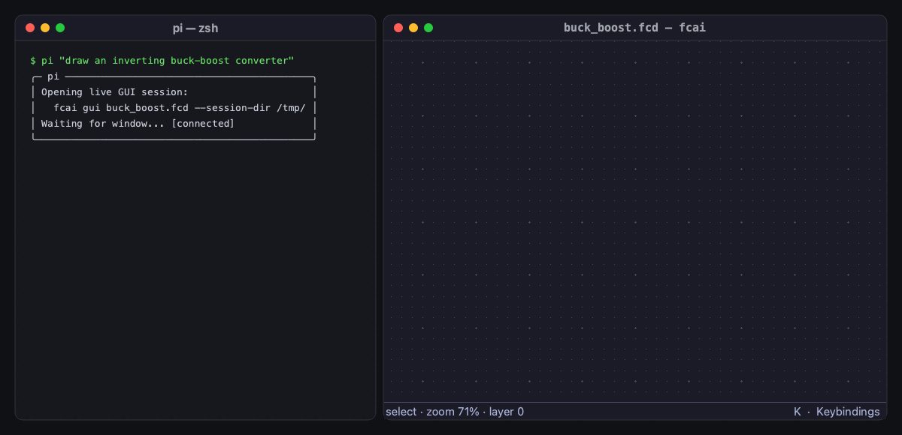
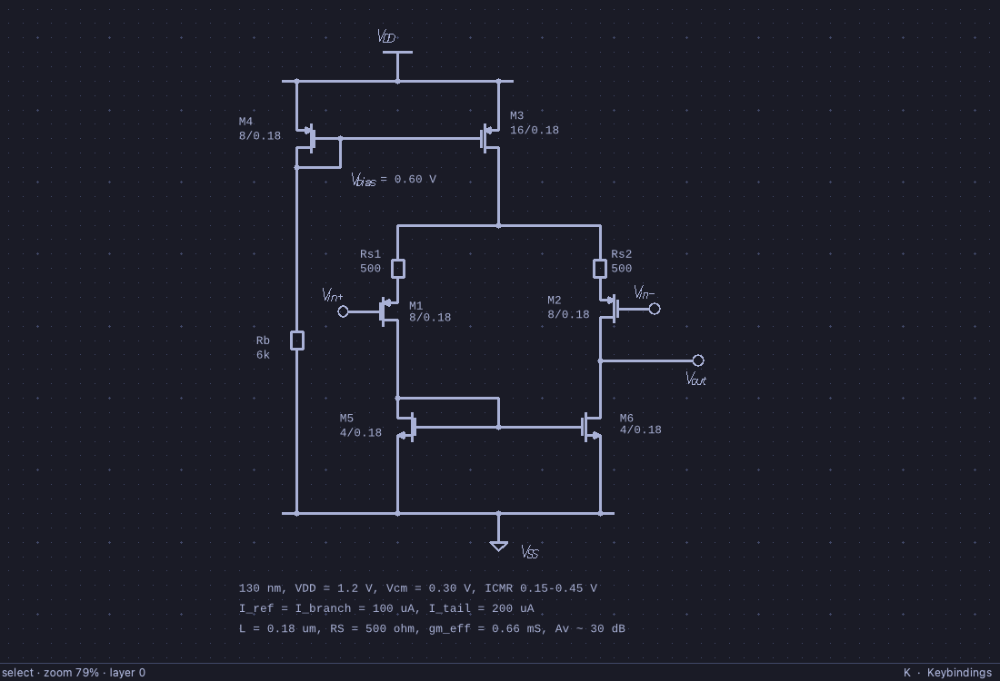
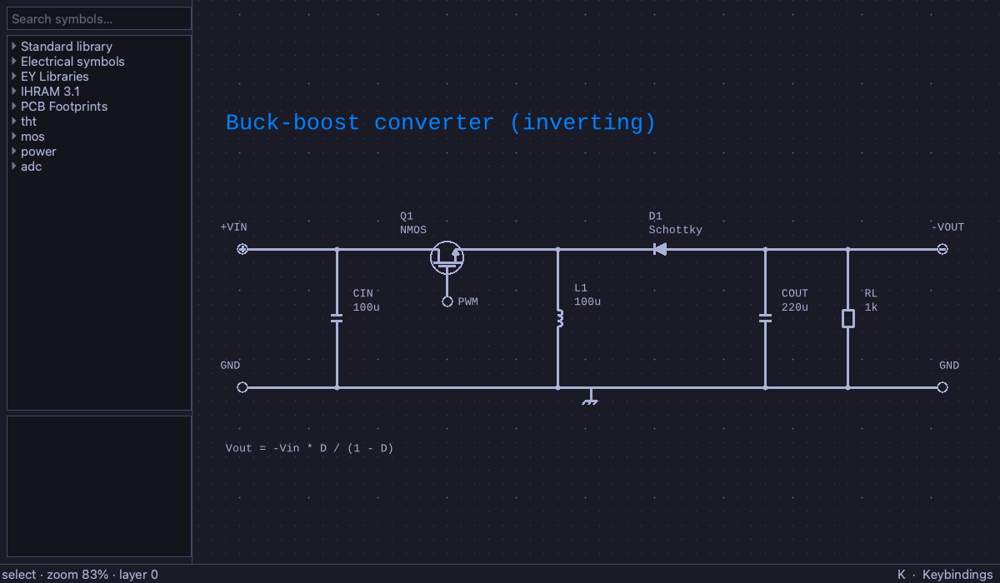
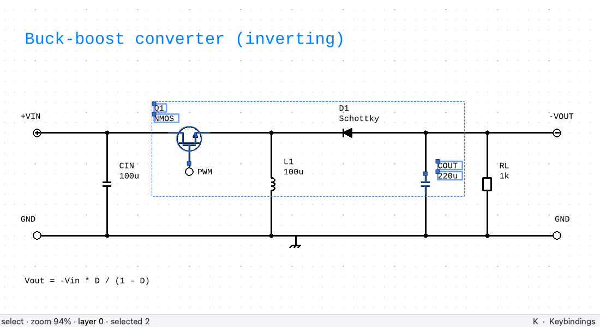

# FidoCadAI

> **AI-native pair programming for electronic schematics and PCB layouts.**  
> Blazing fast, dependency-free C11 engine with a distraction-free collaborative GUI.

[]()
[]()
[]()
[]()

---

## ⚡ Why FidoCadAI?

Traditional EDA suites are heavy, closed, and full of friction. They store circuits in opaque binary blobs that cannot be diffed, version-controlled, or understood by AI.

**FidoCadAI** brings electronics design into the modern developer workflow:

* **Schematics as Code:** Every drawing (`.fcd`) and library (`.fcl`) is pure, human-readable plain text. Git diffs are readable, merges make sense, and parsers run in microseconds.
* **The Window is the Drawing, Your Terminal is the Copilot:** `fcai-gui` has **no toolbars, no menus, and no chat window**. Your coding assistant ([Pi](https://github.com/pi-agent), Claude Code, Antigravity, Codex) stays in your terminal while you watch the schematic evolve live on canvas.
* **Live Bidirectional Collaboration:** The AI draws while you watch. See something you dislike? Tweak a component handle, drag a label, or give spoken feedback in your terminal—the agent incorporates your changes on the fly.
* **Persistent Style Memory (`~/.fcai/style.md`):** Remembers your drawing preferences across sessions and models (e.g. lead lengths, MOS label conventions, rail margins).
* **Instant C11 Speed:** Zero Java runtime, zero Electron bloat. Starts up in < 10 ms, rasterizes to PNG/PPM in sub-milliseconds, and embeds cleanly with a pure C API.

---

## 🎬 Live in Action: Session with Pi

Watch how an interactive session with **Pi** in the terminal designs, modifies, and validates an **inverting buck-boost converter** live:



1. **You ask Pi:** `pi "draw an inverting buck-boost converter"`.
2. **Live sync:** Pi spins up `fcai-gui` in the background with a synchronized session socket.
3. **Step-by-step assembly:** Power rails, switching NMOS $Q_1$, inductor $L_1$, Schottky diode $D_1$, output filter $C_{OUT}$, load resistor $R_L$, and the transfer formula $V_{out} = -V_{in} \cdot \frac{D}{1-D}$ appear in real-time.
4. **Interactive voice feedback:** *"The gate wire is too long. Mount the PWM flag directly on the NMOS gate pin."*
5. **Instant refinement:** Pi identifies the selected wire, removes it, re-anchors the PWM flag, verifies geometry with `fcai validate`, and commits the finished circuit!

---

## 🧪 Built in the Playground

Real circuits designed, iterated, and verified with AI in the [`playground/`](file:///Users/dante/Projects/fidocad/FidoCadAI/playground):

| **130 nm PMOS Differential Pair** (`playground/diff-pair`) | **Inverting Buck-Boost Converter** (`playground/buck-boost`) |
|:---:|:---:|
| [](file:///Users/dante/Projects/fidocad/FidoCadAI/playground/diff-pair/pmos_diffpair_130nm.fcd) | [](file:///Users/dante/Projects/fidocad/FidoCadAI/playground/buck-boost/buck_boost.fcd) |
| *Active current-mirror bias, source degeneration, and native $\LaTeX$ math labels ($V_{DD}, V_{bias}, g_m, V_{out}$).* | *Clean power-stage topology with consistent lead lengths and verified junction dots.* |

| **Buck-Boost 2-Layer PCB Layout** (`playground/buck-boost`) | **2nd-Order VCO-Based $\Sigma\Delta$ ADC** (`playground/vco-adc`) |
|:---:|:---:|
| [](file:///Users/dante/Projects/fidocad/FidoCadAI/playground/buck-boost/buck_boost_pcb.fcd) | [](file:///Users/dante/Projects/fidocad/FidoCadAI/playground/vco-adc/vco_adc.fcd) |
| *PCB tracks, solder pads, thermal reliefs, and silkscreen footprints.* | *System-level modulator block diagram + transistor-level 3-stage current-starved ring oscillator.* |

| **5-Bit Capacitive SAR ADC** (`playground/cap-adc`) | **DeepSeek-V4 Neural Architecture** (`playground/ds4-flash`) |
|:---:|:---:|
| [](file:///Users/dante/Projects/fidocad/FidoCadAI/playground/cap-adc/cap_adc.fcd) | [](file:///Users/dante/Projects/fidocad/FidoCadAI/playground/ds4-flash/v4_flash.fcd) |
| *Binary-weighted capacitor array, custom CMOS switch macros, and SAR register.* | *Hierarchical machine-learning block diagram with matrix-multiplication callouts.* |

---

## 🎨 The GUI: Zero Clutter, Pure Circuit

`fcai-gui` is crafted to be distraction-free. The window **is** the drawing:

| **Dark Mode & Symbol Browser (`Ctrl+B`)** | **Technical Light Mode & Handle Dragging** |
|:---:|:---:|
| [](docs/images/fcai_gui_palette.png) | [](docs/images/fcai_gui_light.png) |
| *Instant search across standard and user libraries with live macro preview.* | *Interactive control-point handles: reshape components and position labels independently.* |

* **Single-key editing:** `S` select · `L` line · `B` rectangle · `E` ellipse · `J` connection dot · `T` text · `R` rotate · `M` mirror · `Space` fit-to-view.
* **Smart label handles:** Attached component names and values have their own handles. Drag labels anywhere without moving the component body.
* **Ruler measurement:** `Right-drag` (or `Shift+drag`) measures exact distance in drawing units, millimeters, and angle.
* **Omarchy & OS theming:** Seamlessly tracks your system theme, font, and desktop tiling.

---

## 🚀 Quick Start

### 1. Build & Install

```bash
# Clone and build core CLI + GUI
git clone https://github.com/DanteCpp/FidoCadAI.git
cd FidoCadAI
make

# System-wide install (/opt/FidoCadAI, symlinks in /usr/local/bin, auto-installs AI skill)
sudo scripts/install.sh install
```

> **Requirements:** C11 compiler (clang/gcc) and `make`.  
> For the GUI (`fcai-gui`): Qt6 (`brew install qt` on macOS, `apt install qt6-base-dev` on Linux). Core CLI builds with zero dependencies!

### 2. Pair with Your AI Agent

FidoCadAI automatically links its skill into your local agent harnesses (**Pi**, **Claude Code**, **Antigravity**, **Codex**, **Gemini**).

Simply ask your agent in any directory:
```bash
# With Pi:
pi "draw a CMOS bandgap reference circuit"

# With Claude Code:
claude "open fcai gui and sketch a non-inverting op-amp amplifier"
```

The agent opens `fcai-gui`, builds the schematic in real time, and saves the verified `.fcd` file when you're satisfied.

---

## 🛠️ CLI Power Tools

For scripts, CI pipelines, and command-line workflows:

```bash
# Render schematic to high-res PNG (with LaTeX math & grid)
fcai render circuit.fcd --grid -o circuit.png

# Syntax validation, linting & round-trip verification
fcai validate circuit.fcd
fcai lint circuit.fcd --json

# Semantic primitive-level diff between two circuit revisions
fcai diff before.fcd after.fcd

# Machine-readable AST for LLMs / tools
fcai context circuit.fcd
fcai json circuit.fcd

# Manage persistent style preferences
fcai style show
fcai style set mos-labels "Place MOS labels beside the body at mid-height."
```

---

## 🧩 C API (Embed in Your App)

Include the single header and link with libc:

```c
#include "fidocad.h"

FcDrawing d;
FcLib *lib = fc_lib_new();
fc_drawing_init(&d);

fc_lib_load_stdlib(lib, argv[0]);
fc_parse_file(&d, "schematic.fcd");

// Validate and render directly to PNG
fc_render_file(&d, lib, NULL, "output.png");

fc_drawing_free(&d);
fc_lib_free(lib);
```

---

## 📁 Repository Layout

```
├── include/fidocad.h     # Public C API
├── src/                  # Core parser, emitter, software rasterizer, CLI
├── gui/                  # Lightweight Qt6 collaborative editor (fcai-gui)
├── playground/           # Real-world circuits, PCB designs, and session logs
├── share/lib/            # Bundled standard electronic component libraries (.fcl)
├── share/skills/fidocad/ # Universal agent skill (Pi, Claude, Antigravity, Codex)
├── scripts/install.sh    # System installer & automatic Git update hook
└── tests/                # Unit test suite & offscreen headless GUI tests
```

---

## 📜 Credits & License

* **Core & GUI:** Licensed under [GPLv3](LICENSE).
* **Reference Projects:** [FidoCadJ](https://github.com/DarwinNE/FidoCadJ) (Java) by Davide Bucci and [FidoCadJS](https://github.com/DarwinNE/FidoCadJ) (TypeScript).
* **Rasterizer & Fonts:** Vendors [stb](https://github.com/nothings/stb) (`stb_truetype`, `stb_image_write`) and [Liberation Fonts](https://github.com/liberationfonts/liberation-fonts) (SIL Open Font License 1.1).
