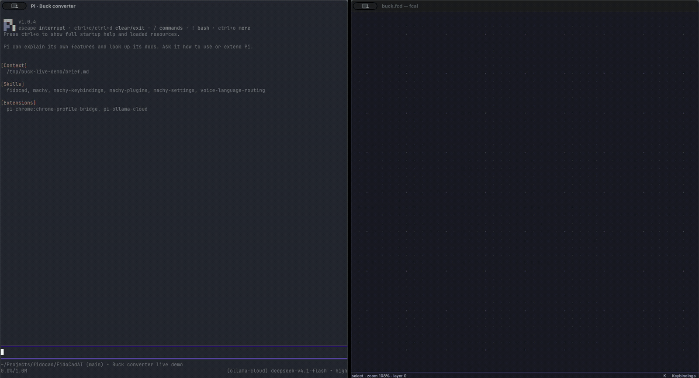
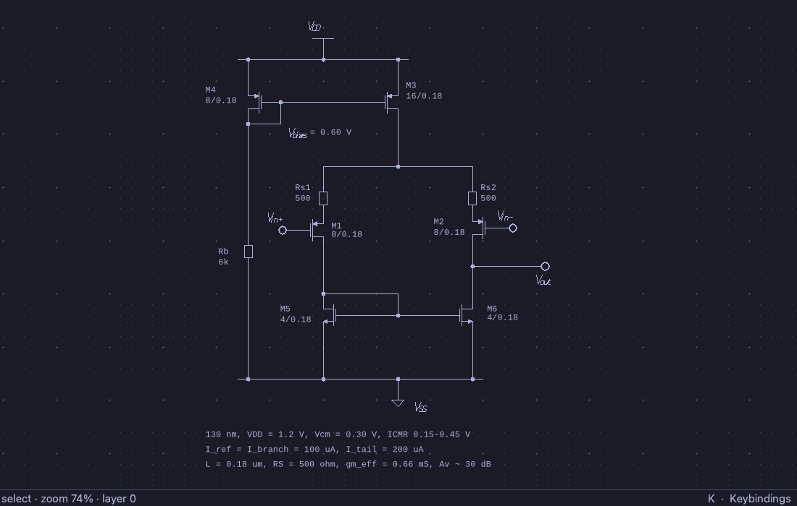
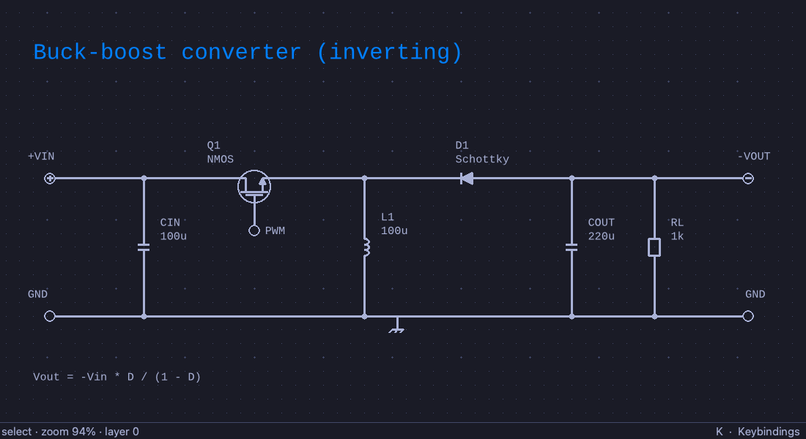
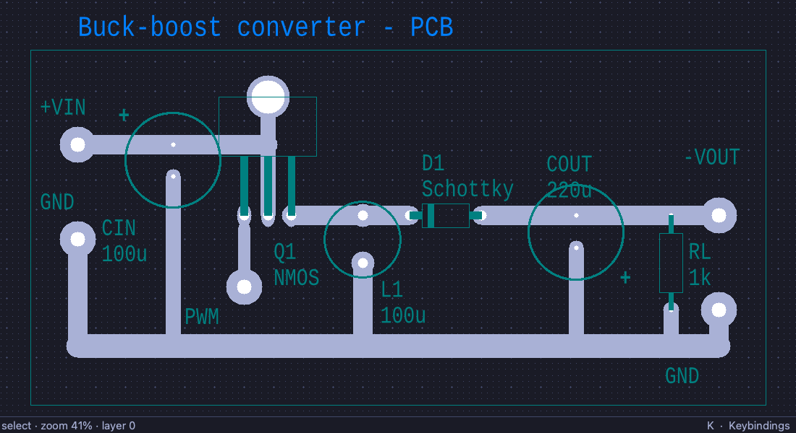
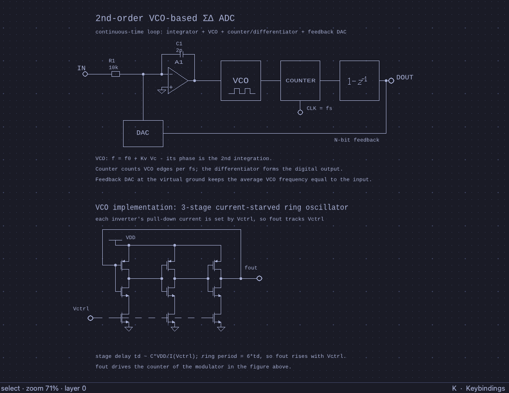
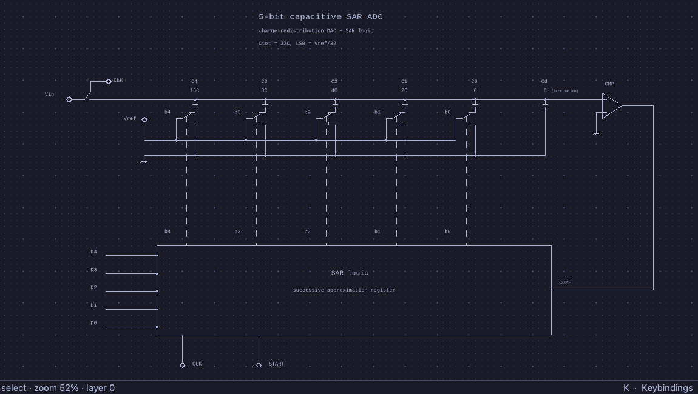
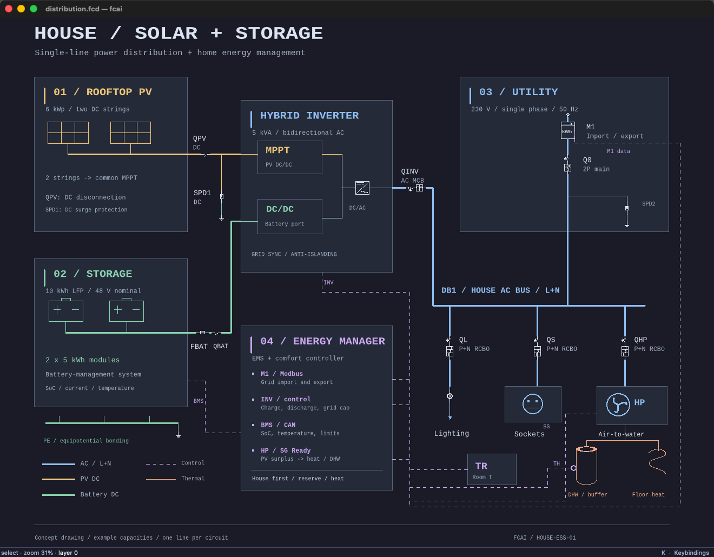
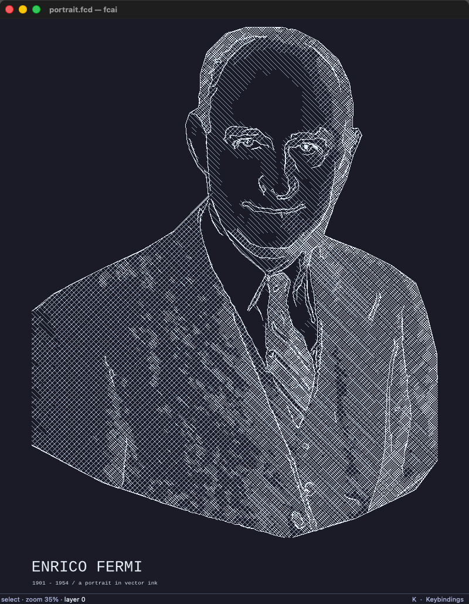

# FidoCadAI

Draw circuits by talking to your agent.

FidoCadAI gives you and your AI agent a shared drawing canvas. Ask for a circuit, inspect the result, then answer on the canvas itself: select a component, move a label or adjust a wire. Your selections and edits are shared automatically, so the next request can refer to what you just touched.

The conversation stays in your terminal. The drawing stays open beside it, and you can edit it by hand at any point.

I've used FidoCadJ since high school, through university, and the years since. It has been a blank page for thinking: somewhere to sketch circuits, systems and ideas of all kinds. FidoCadAI brings an agent into that way of working.

You can use it to draw schematics and design simple PCB layouts, or as a companion for exploring an idea. The drawing gives the conversation something concrete to work with: a way to explore an arrangement, question it and develop it further.

## An example session

Drawing a buck converter with Pi:

[Drawing and symbol library](playground/buck-demo/)

## Working with the drawing

I come from chip design, so some keybindings and canvas navigation borrow from tools such as Cadence. The interface also draws on Omarchy, on macOS for trackpad navigation, and on FidoCadJ for ideas such as rulers and shortcuts for drawing primitives.

The interface is deliberately simple. The drawing fills the window, with tools available from the keyboard when you need them. You can move between conversation and direct editing without leaving the drawing or interrupting the session. The aim is to keep your attention on the idea you are working through.

FidoCadAI ships with a skill: written instructions that teach an agent how to use the tools. It carries some of my own preferences in schematic drawing as a starting point. Memory and style learning are enabled by default: the agent learns from your feedback, remembers your preferences across sessions and applies them to later drawings. Over time, the drawings reflect more of your own style.

## Why it is built this way

A FidoCad drawing is plain, human-readable text. Its simple commands make it possible for a language model to infer how to draw from examples, even before reading the specification. The essentials of the drawing language fit on a single page, so explaining it takes little of the agent's context and leaves room for the design itself. You can also read the files yourself, track changes in Git and share drawings that remain editable.

I chose C over Rust because of its long history and the large body of established code available for language models to learn from. I wanted the implementation to be straightforward for agents to read and extend, as well as fast to run. The core and command-line tool are lean C11 programs with no external dependencies beyond the C standard library. The drawing window uses Qt6.

The agent works through the command-line tool, `fcai`, while you see the result in `fcai-gui`. It draws, renders, inspects and corrects. Keeping that cycle quick lets it check its work visually as the drawing develops.

The language model interprets your requests and makes the design decisions, so results depend on the model you use. The tools let it inspect the drawing's syntax, wire geometry and appearance; those checks do not establish that a circuit will work electrically.

## Examples

These examples range from circuit details to a house energy system and a portrait. Each uses the same text-based drawing format. Editable sources live in [`playground/`](playground/); click an image to open the full-resolution render.

The buck-boost pair shows a schematic and a PCB layout. The ADC drawings use repeated circuit elements and labels to describe more detailed structures.

| **Buck-Boost Schematic** | **Buck-Boost PCB Layout** |
|:---:|:---:|
|  |  |
| Power-stage topology and component labels. [FidoCad source](playground/buck-boost/buck_boost.fcd) | Copper tracks, pads, and silkscreen. [FidoCad source](playground/buck-boost/buck_boost_pcb.fcd) |

| **VCO-Based Sigma-Delta ADC** | **Capacitive SAR ADC** |
|:---:|:---:|
|  |  |
| Modulator and current-starved ring oscillator. [FidoCad source](playground/vco-adc/vco_adc.fcd) | Binary-weighted capacitor array and SAR register. [FidoCad source](playground/cap-adc/cap_adc.fcd) |

**Solar + Storage House — Single-Line Drawing**

This drawing brings electrical and thermal systems onto one canvas: rooftop solar, battery storage, a hybrid inverter, house circuits and heat-pump heating. Colours and line styles distinguish power, control signals and heat flow.

[Editable drawing and symbol library](playground/unifilar/) · Blue: AC power · Gold: PV DC · Green: battery / PE · Violet dashes: logical controls · Orange: thermal flow

**Enrico Fermi Portrait**

The same lines used for circuits can also describe a face. This portrait is made of editable outlines and cross-hatching, with no embedded photograph.

  

[Editable artwork and reference photograph](playground/enrico-fermi/)

## Try it

FidoCadAI runs on Linux and macOS with a coding agent such as Pi, Codex or Claude Code. Give your agent this repository and ask it to install FidoCadAI, read the included skill and open a drawing. Building requires a C11 compiler, Make and Qt6 for the drawing window; the [installer](scripts/install.sh) and [agent instructions](share/skills/fidocad/SKILL.md) cover setup and use.

A first request can be as simple as “Draw an inverting buck-boost converter.” Once the drawing is open, select something you want to change and continue the conversation.

## Credits and license

* **Core & GUI:** Licensed under [GPLv3](LICENSE).
* **Reference Projects:** [FidoCadJ](https://github.com/DarwinNE/FidoCadJ) (Java) by Davide Bucci and [FidoCadJS](https://github.com/DarwinNE/FidoCadJ) (TypeScript).
* **Rasterizer & Fonts:** Vendors [stb](https://github.com/nothings/stb) (`stb_truetype`, `stb_image_write`) and [Liberation Fonts](https://github.com/liberationfonts/liberation-fonts) (SIL Open Font License 1.1).
